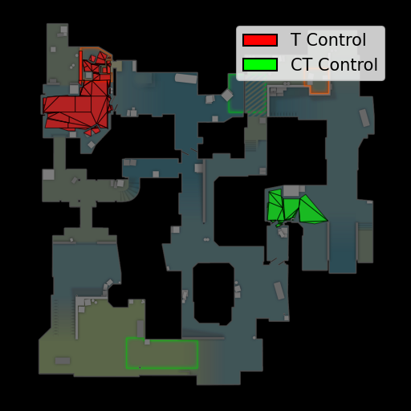
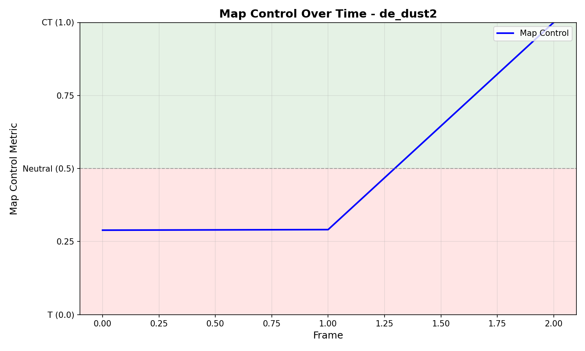
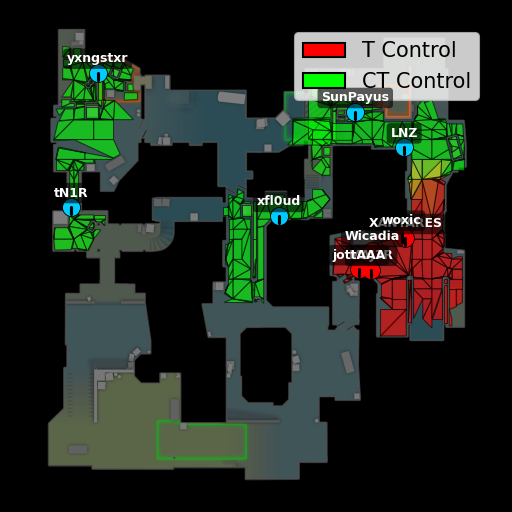

# Map Control for CS2 (awpy v2)

A Polars-native CS2 port of the map control analytic from the original CS:GO awpy
package, extended with conical (threat-aware) BFS, weapon-class-specific cone
geometry, a Z-floor gate for vertically-stacked maps, and a visualization stack
that draws per-tile heatmaps, round timelines, animated GIFs, and player overlays.
This document is the entry point for the implementation. Companion documents
cover analysis methodology and findings ([./ANALYSIS.md](./ANALYSIS.md)),
roadmap ([./FUTURE_WORK.md](./FUTURE_WORK.md)), and longer-horizon research
direction ([./RESEARCH_VISION.md](./RESEARCH_VISION.md)). The visual gallery
across nine competitive maps lives at
[../examples/map_control_validation/index.html](../examples/map_control_validation/index.html).

## 1. What this is + motivation

### Elevator pitch

Map control is the most basic spatial-strategic metric in tactical shooters: at
any moment in a round, *who controls which parts of the map?* The original CS:GO
awpy package shipped a navigation-mesh BFS that propagated control values from
every alive player's tile and converted the team-wise sums to a per-tile
`CT_sum / (CT_sum + T_sum)` ratio. We re-implement that analytic on top of the
CS2 awpy v2 stack — Polars DataFrames, `awpy.nav.Nav` for nav-mesh access, and
`demoparser2` for tick parsing — and extend it in three ways. First, a
*conical* BFS variant in which a player's threat is propagated only inside a
cone of half-angle `theta` around their yaw, with depth, half-angle, and
falloff parameters that depend on the player's active weapon class. Second, a
Z-floor gate that prevents the 2D bearing computation from bleeding cone
coverage across vertically stacked nav areas (the upper-versus-lower problem on
nuke). Third, a visualization stack — heatmaps, timelines, and GIFs with
optional player markers and yaw arrows — built directly on the Polars schema
that `awpy.demo.Demo.parse()` produces.

### Algorithm intuition

We start from the original CS:GO formulation and keep its semantics as the
default fallback so that any caller upgrading from the legacy implementation
sees identical numbers. The *circular* BFS, given a player's current nav tile
as the source, walks the nav graph breadth-first up to `max_depth` hops. The
value assigned to a tile reached in `hops` hops is

```
value = (max_depth - hops) / max_depth
```

i.e. linear falloff in graph distance. The source tile gets `1.0`. Each
team's contribution at a tile is the *list* of values it received from every
alive teammate; the per-tile metric is the sum of CT contributions divided by
the sum of CT plus T contributions, so the metric lives in `[0, 1]` with `0`
meaning fully T and `1` meaning fully CT. The frame-level metric is a
polygon-area-weighted average across tiles via the shoelace formula on each
tile's `corners` (`awpy/stats/map_control.py:_compute_polygon_area`).
Polygon-area weighting matters because nav tiles vary substantially in size
(open areas like dust2 long are tiled with a few large quads, while corridors
and ramps are tiled with many small triangles), and we want the metric to
reflect physical area controlled, not just *number of tiles* controlled.

The conical extension addresses the most common complaint about the legacy
metric: a player holding an AWP at mid does not threaten tiles behind them or
on the far side of the map. We replace circular BFS with a directional model.
Given a player's yaw `phi` and weapon class, we look up cone parameters
`(max_depth, half_angle_deg, falloff_exponent, rear_depth, rear_multiplier)`
in `WEAPON_CONE_PARAMS`, then for every nav tile reachable within
`max_depth` hops compute the 2D bearing from the player's source-tile centroid
to the candidate tile's centroid. The angular term is

```
angle_w = cos(angle_from_facing scaled to [0, pi/2]) ** falloff_exponent
```

zero outside the cone, and the final value is `range_w * angle_w` where
`range_w` matches the linear hops-falloff used in the circular case. A small
*rear halo* — a uniform, heavily attenuated weight inside `rear_depth` hops
behind the player — captures peripheral / audio awareness. The Z-floor gate
discards neighbor tiles whose mean Z differs from the source by more than a
configurable threshold (recommended 150 source units on nuke), preventing the
2D bearing check from "seeing through" the floor on stacked nav areas.

We picked weapon-class cone parameters from a combination of CS2 weapon
accuracy tables and empirical kill-distance distributions extracted from
HLTV demos via the ETL pipeline. AWPs get a tight 15-degree cone with
sharp `cos^4` falloff and a 20-hop reach; rifles get a 40-degree cone with
`cos^2` falloff and 15 hops; SMGs widen further; shotguns are short-range but
75 degrees wide; knives become an effective 360-degree two-hop halo. Full
table in section 3.

### Why we kept the BFS

We considered three alternative formulations during the design phase: a
flow-network model where each player pushes a fixed amount of "control
flow" along edges, a continuous PDE approach where threat diffuses on a
weighted graph, and a learned per-tile classifier trained against round
outcomes. We kept BFS for three reasons. First, it preserves bit-exact
backward compatibility with the original CS:GO implementation, which means
we can compare any new analytic side-by-side against an unchanged reference.
Second, BFS is straightforward to extend with a directional cone — the
modification touches only the per-neighbor weight, not the traversal
structure, so the walk itself remains the same `O(V+E)` and the LRU cache
is keyed on a small tuple. Third, a learned classifier without a strong
prior tends to memorize training-time biases (specific maps, specific eras
of the meta), and we wanted an analytic that runs on a fresh map with no
training data.

## 2. Quickstart

The shortest path from a `.dem` file to a frame heatmap requires three things:
a parsed Polars DataFrame of ticks, the nav mesh for the map, and the visual
backdrop image that `awpy.plot.map_control` draws onto. The nav mesh and
image are downloaded by the `awpy get` CLI on first use.

```python
# 1) Download nav mesh + map image (one-off, per map).
#    Run from the shell: awpy get nav de_dust2
#    Run from the shell: awpy get maps de_dust2

# 2) Parse a demo. The ticks DataFrame is the only thing the public map
#    control API consumes — it is filtered down to a single tick or a single
#    round and passed in directly.
from awpy.demo import Demo

demo = Demo("aurora-vs-heroic-m2-dust2.dem")
demo.parse()
print(demo.ticks.columns)
# ['tick', 'steamid', 'name', 'round_num', 'side', 'X', 'Y', 'Z',
#  'health', 'armor', 'place', 'current_equip_value', 'has_defuser',
#  'has_helmet', 'weapon_name', 'velocity_X', 'velocity_Y', 'velocity_Z',
#  'yaw', 'pitch', 'flash_duration', 'zoom_lvl', 'is_walking',
#  'duck_amount', 'spotted', 'is_bomb_planted', 'which_bomb_zone',
#  'game_time']
```

Compute one frame metric and print the polygon-area-weighted scalar in
`[0, 1]`. Pass `MapControlConfig(use_conical_bfs=True)` to switch on the
weapon-aware cone model — the call still works without `weapon_name` or
`yaw`, in which case it silently falls back to circular BFS.

```python
import polars as pl
from awpy.stats import (
    MapControlConfig,
    get_map_control_tick_metric,
    get_round_map_control_frame_metrics,
)

# A single tick — pull all 10 player rows from one tick.
tick_df = demo.ticks.filter(pl.col("tick") == 67200)

cfg = MapControlConfig(use_conical_bfs=True, z_floor_threshold=0.0)
score = get_map_control_tick_metric("de_dust2", tick_df, config=cfg)
print(f"frame map control = {score:.3f}  (0=T, 1=CT)")

# A whole round of frames (one metric per tick group).
round_df = demo.ticks.filter(pl.col("round_num") == 5)
metrics = get_round_map_control_frame_metrics("de_dust2", round_df, config=cfg)
print(f"round 5 has {len(metrics)} frames")
```

Render a per-tile heatmap and a round timeline.

```python
import matplotlib.pyplot as plt
from awpy.stats.map_control import (
    get_tick_map_control_tile_values,
    _generate_FrameMapControlTileMetrics_object,
)
from awpy.plot.map_control import (
    plot_frame_map_control_tile_metrics,
    plot_frame_map_control_with_players,
    plot_round_map_control_frame_metrics,
)

# Frame heatmap — colormap is red-yellow-green for T-neutral-CT.
tile_values = get_tick_map_control_tile_values("de_dust2", tick_df, config=cfg)
tile_metrics = _generate_FrameMapControlTileMetrics_object(tile_values)
fig, _ = plot_frame_map_control_tile_metrics(tile_metrics, "de_dust2")
fig.savefig("frame.png", dpi=200)
plt.close(fig)

# Same heatmap with player markers and yaw arrows on top.
fig, _ = plot_frame_map_control_with_players(
    tile_metrics, tick_df, "de_dust2", show_player_names=True
)
fig.savefig("frame_with_players.png", dpi=200)
plt.close(fig)

# Round timeline — line plot of frame metric over ticks.
fig, _ = plot_round_map_control_frame_metrics(metrics, "de_dust2")
fig.savefig("round5_timeline.png", dpi=200)
plt.close(fig)
```

A full real-demo example with sample outputs lives in
`scripts/analyze_real_demo.py`, which renders heatmaps and a round GIF for
Aurora vs. Heroic on dust2. The smaller smoke-test variant is
`scripts/quick_test_real_demo.py`.

A few practical notes for production use of these snippets. The `tick_df`
filter must contain rows for both teams within a single tick — the BFS does
not interpolate across ticks, so passing a multi-tick frame mixes the
contributions and produces nonsense. The `round_df` filter, on the other
hand, can span the entire round; `get_round_map_control_frame_metrics`
groups by tick internally and returns one entry per tick group. If you need
to subsample (the GIF helpers do exactly this with their `tick_interval`
parameter), filter to a stride before calling the round-level helper.



## 3. API surface

The public surface is intentionally small. The two modules below expose every
function and dataclass we expect external code to call directly. Internal
helpers (prefixed `_`) are reachable but not part of the stability contract.

### `awpy.stats` — analytics

| Symbol | Kind | Signature / one-liner |
|---|---|---|
| `MapControlConfig` | dataclass | Feature flags + tunables (see flag table below). |
| `WEAPON_CLASSES` | constant | Tuple of canonical class names: `("awp", "rifle", "smg", "pistol", "shotgun", "knife")`. |
| `WEAPON_CONE_PARAMS` | constant | Per-class dict of `max_depth`, `half_angle_deg`, `falloff_exponent`, `rear_depth`, `rear_multiplier`. |
| `FrameMapControlTileValues` | dataclass | `t_values: dict[int, list[float]]`, `ct_values: dict[int, list[float]]` for one tick. |
| `clear_nav_cache()` | function | Drop module-level nav, centroid, and conical-BFS LRU caches. Useful in tests. |
| `get_tick_map_control_tile_values(map_name, tick, config=None)` | function | Run BFS for both teams; return raw per-team per-tile contribution lists. |
| `get_map_control_tick_metric(map_name, tick, config=None)` | function | Polygon-area-weighted scalar in `[0, 1]` for one tick. |
| `get_round_map_control_frame_metrics(map_name, round, config=None)` | function | List of per-tick scalars across a round, one entry per tick group. |

`tick` and `round` arguments are Polars `DataFrame`s with one row per player
per tick. The required columns are `X`, `Y`, `Z`, `side`, and `health`. With
`config.use_conical_bfs=True` the code additionally consumes `yaw` (mandatory
for the cone direction) and either `weapon` or `current_equip_value`
(used to classify weapon class — see `_classify_weapon`). When `armor` is
present we use the `(health + armor) > 0` alive check; otherwise we fall back
to `health > 0` only. See `awpy/stats/map_control.py:493-496`.

### `awpy.plot.map_control` — visualization

| Symbol | Kind | Signature / one-liner |
|---|---|---|
| `plot_frame_map_control_tile_metrics(metrics, map_name)` | function | Heatmap of tile-level metric values on the map backdrop. Returns `(Figure, Axes)`. |
| `plot_frame_map_control_with_players(metrics, tick_data, map_name, show_player_names=True, player_marker_size=8.0, arrow_length_multiplier=2.0)` | function | Same heatmap with alive players drawn as red/cyan markers and yaw arrows. |
| `plot_round_map_control_frame_metrics(round_metrics, map_name)` | function | Line plot of the per-frame scalar over a round, with shaded T/CT regions. |
| `save_round_map_control_tile_metrics_gif(round_metrics, map_name, output_path, duration=100)` | function | Render each frame's tile heatmap and stitch into an animated GIF. |
| `save_round_map_control_with_players_gif(round_data, map_name, output_path, duration=500, tick_interval=384, show_player_names=True, player_marker_size=8.0)` | function | Sample ticks at `tick_interval`, compute tile metrics inside the loop, render each frame with player overlays, stitch to GIF. |

The colormap is a custom `LinearSegmentedColormap` running pure red at `0.0`
through yellow at `0.5` to pure green at `1.0`. Both GIF helpers call
`plt.close(fig)` at the end of each frame loop iteration — this is required to
prevent matplotlib from accumulating figures and exhausting memory on long
rounds.



### `MapControlConfig` flag table

The dataclass at `awpy/stats/map_control.py:391-447` is the single switchboard
controlling which features are active. The flags are split into "implemented"
and "stubbed for future work". Stubbed flags are accepted by the dataclass but
do nothing yet; future work documented in [./FUTURE_WORK.md](./FUTURE_WORK.md)
will wire them up.

| Flag | Default | Status | Effect |
|---|---|---|---|
| `bfs_depth` | `10` | implemented | Max hops for circular BFS (legacy mode). |
| `use_conical_bfs` | `False` | implemented | Switch from circular to cone model. Requires `yaw`; weapon classification falls back to `current_equip_value` if `weapon` column is absent. |
| `yaw_bucket_deg` | `10.0` | implemented | Yaw quantization for the conical BFS LRU cache. Custom values bypass the cache; see "Known limitations". |
| `cone_params_override` | `None` | implemented | Optional `dict[class, partial_params]` merged on top of `WEAPON_CONE_PARAMS` per call. |
| `rear_halo_enabled` | `True` | implemented | Toggle the small rear-awareness halo inside `rear_depth` hops. |
| `z_floor_threshold` | `0.0` | implemented | Z difference (source units) above which neighbor tiles are skipped. `0` disables; `150` is the recommended nuke value. |
| `smoke_blocking_enabled` | `False` | stubbed | Block BFS propagation through active smoke positions. |
| `smoke_radius` | `144.0` | stubbed | Companion radius for `smoke_blocking_enabled`. |
| `molotov_denial_enabled` | `False` | stubbed | Down-weight molotov-covered tiles. |
| `molotov_radius` | `96.0` | stubbed | Companion radius for `molotov_denial_enabled`. |
| `flash_weight_enabled` | `False` | stubbed | Scale a flashed player's contribution by `flash_weight_multiplier`. |
| `flash_weight_multiplier` | `0.1` | stubbed | Companion weight for `flash_weight_enabled`. |
| `sightline_enabled` | `False` | stubbed | Use `awpy.visibility.VisibilityChecker` to gate cone tiles by line of sight. |
| `sightline_forward_angle` | `90.0` | stubbed | Companion angle for `sightline_enabled`. |
| `sightline_rear_multiplier` | `0.5` | stubbed | Companion multiplier for `sightline_enabled`. |
| `weapon_weight_enabled` | `False` | stubbed | Multiply per-player contribution by a class-dependent "impact" weight. |

### `WEAPON_CLASSES` and `WEAPON_CONE_PARAMS`

Six classes in canonical order: `awp`, `rifle`, `smg`, `pistol`, `shotgun`,
`knife`. The cone parameters live in `awpy/stats/map_control.py:340-383`.

| Class | `max_depth` | `half_angle_deg` | `falloff_exponent` | `rear_depth` | `rear_multiplier` |
|---|---:|---:|---:|---:|---:|
| `awp` | 20 | 15.0 | 4.0 | 2 | 0.10 |
| `rifle` | 15 | 40.0 | 2.0 | 3 | 0.15 |
| `smg` | 10 | 55.0 | 1.5 | 3 | 0.20 |
| `pistol` | 12 | 40.0 | 2.0 | 3 | 0.15 |
| `shotgun` | 5 | 75.0 | 1.5 | 2 | 0.25 |
| `knife` | 2 | 180.0 | 0.0 | 0 | 0.00 |

`max_depth` is approximately effective range in meters because a hop on
dust2 is roughly one meter on average. `half_angle_deg=180.0` for knife means
the cone covers the full 360-degree disk; combined with `falloff_exponent=0.0`
it becomes a uniform two-hop halo. The classifier in `_classify_weapon` (lines
259-311) accepts both demoparser2 display names (`"AK-47"`, `"AWP"`,
`"Butterfly Knife"`) and internal lower-snake names (`"ak47"`, `"awp"`,
`"knife_butterfly"`). Utility items (`"Smoke Grenade"`, `"Flashbang"`,
`"Molotov"`, `"C4 Explosive"`, etc.) currently map to `knife` so a player
mid-throw is not treated as a rifle threat. When only `current_equip_value` is
available we fall back to a numeric tier classifier with thresholds
`>=6200 -> awp`, `>=4000 -> rifle`, `>=2200 -> smg`, `>=700 -> pistol`,
otherwise `knife`.

## 4. Testing + validation

We rely on three layers of testing: synthetic unit tests for the visualization
API, a focused visibility test on dust2, and end-to-end real-demo smoke tests
that we eyeball through the validation gallery.

### Running the suite

```python
# From the repo root, all three test files exercise distinct surfaces.
# uv run pytest tests/test_map_control_visualization.py tests/test_visibility.py -v
```

### What is covered

`tests/test_map_control_visualization.py` defines 30 tests across seven
classes. The classes are:

- `TestPlotFrameMapControlTileMetrics` — four tests covering the basic
  `(Figure, Axes)` return contract, empty-metrics handling, figure size, and
  invalid-map error propagation.
- `TestPlotRoundMapControlFrameMetrics` — six tests covering the timeline:
  return types, empty input, single metric, multi-metric line length, y-axis
  limits forced to `[0, 1]`, and out-of-range values.
- `TestSaveRoundMapControlTileMetricsGif` — four tests covering successful GIF
  creation, single-frame GIFs, the `IndexError` raised by an empty list, and
  custom output paths.
- `TestVisualizationIntegration` — two tests including a memory-leak guard
  that opens five figures in a loop and asserts that figure counts do not
  accumulate.
- `TestEdgeCases` — eight tests covering all-T, all-CT, and neutral frames,
  T-dominant and CT-dominant rounds, T-to-CT control shifts, GIFs with varying
  per-frame tile counts, and custom GIF frame durations.
- `TestPlotFrameMapControlWithPlayers` — four tests covering the player-
  overlay variant: standard render, all-dead players, missing required
  columns, and empty input.
- `TestSaveRoundMapControlWithPlayersGif` — two tests covering the player-
  overlay GIF and empty-round-data error handling.

`tests/test_visibility.py` runs a single `test_basic_visibility` exercising
`VisibilityChecker` on dust2 with five hardcoded point pairs (T spawn pair,
T-spawn-to-CT-spawn, mid doors, long A near site, mid-doors-to-T-spawn). For
each pair we assert that the BVH-accelerated check matches the brute-force
check, that both match the ground truth, and that visibility is symmetric in
both directions — so each pair effectively covers four assertions.

### Real demos and the validation gallery

`scripts/analyze_real_demo.py` is the end-to-end smoke test we run when
making non-trivial changes to the BFS code. It loads a single real CS2 .dem
file, runs the conical BFS, renders frame heatmaps, and saves a per-round
GIF. `scripts/quick_test_real_demo.py` is a shorter variant useful for fast
iteration.

The visual validation grid at
[../examples/map_control_validation/index.html](../examples/map_control_validation/index.html)
walks all nine competitive maps (`de_ancient`, `de_anubis`, `de_dust2`,
`de_inferno`, `de_mirage`, `de_nuke`, `de_overpass`, `de_train`,
`de_vertigo`) through synthetic and real-demo frames side by side. It also
contains overlap, sightline, and tile-to-place visualizations.



We have animated round GIFs for dust2 and nuke at
`../examples/de_dust2.gif` and `../examples/de_nuke.gif`. They are referenced
from the validation gallery.

Tile-to-place coverage on dust2 reaches 100% (all 24 named regions populated
across every tile) when we aggregate `last_place_name` from 10 pro-demo
replays. The inferred mapping lives at
`../examples/map_control_validation/tile_to_place_dust2_full.json`. Maps
beyond dust2 still rely on whatever per-tile place names the published nav
ships with.

### A known testing gap

There is no analytics-level test that pins down the exact tile values
returned by `get_tick_map_control_tile_values`. The visualization tests
exercise the rendering path on synthetic dictionaries, and the visibility
tests exercise the BVH on hardcoded points, but the BFS itself is currently
covered only via the visual gallery and the real-demo smoke scripts. Adding
a numeric regression test that fixes the tile-value dictionary for a known
tick on dust2 is one of the highest-value cleanups remaining.

## 5. Architecture + key files

| File | Lines | Role |
|---|---:|---|
| `awpy/stats/map_control.py` | 1150 | Core BFS engine, conical extension, weapon classification, caches. |
| `awpy/plot/map_control.py` | 579 | Visualization stack: heatmaps, timelines, GIFs, player overlays. |
| `awpy/visibility.py` | 786 | KV3 / VPhys parser, BVH-based `VisibilityChecker`, AABB ray tests. Not yet wired into BFS. |
| `awpy/stats/__init__.py` | 32 | Public exports for the analytics module. |
| `awpy/plot/__init__.py` | 50 | Public exports for the plotting module. |
| `tests/test_map_control_visualization.py` | 636 | 30 tests across seven classes. |
| `tests/test_visibility.py` | 102 | Five-pair dust2 visibility test. |
| `scripts/etl_pipeline.py` | 1893 | Demo-to-Parquet-to-DuckDB ETL. |
| `scripts/analyze_real_demo.py` | various | End-to-end real-demo smoke test. |
| `scripts/quick_test_real_demo.py` | various | Fast variant of the above. |

### Caches

There are three module-level caches in `awpy/stats/map_control.py`:
`_nav_cache: dict[str, awpy.nav.Nav]`, `_centroid_cache: dict[str, dict[int,
tuple[float, float]]]`, and `_z_centroid_cache: dict[str, dict[int, float]]`.
The first eliminates repeated `Nav.from_json` disk reads — without it, every
`get_tick_map_control_tile_values` call paid five disk parses (one for each
of CT and T BFS plus the polygon-area weighting plus the centroid lookups).
The second and third memoize the per-tile centroid computation that the
conical BFS does in its bearing calculations. `clear_nav_cache()` drops all
three plus the conical BFS LRU and is exported for tests and long-running
processes.

The conical BFS itself is wrapped in an LRU cache:

```python
@lru_cache(maxsize=100_000)
def _conical_bfs_cached(
    map_name: str,
    source_tile: int,
    yaw_bucket: int,
    weapon_class: str,
    rear_halo_enabled: bool,
    params_key: tuple,
    z_floor_threshold_int: int = 0,
) -> tuple[tuple[int, float], ...]:
```

The cache key is `(map_name, source_tile, yaw_bucket, weapon_class,
rear_halo_enabled, params_key, z_floor_threshold_int)` where `yaw_bucket` is
`int(round(yaw % 360 / 10))` (10-degree buckets), `params_key` is the cone
parameter tuple flattened to be hashable, and `z_floor_threshold_int` is the
integer-rounded threshold. The cache returns a sorted tuple of
`(tile_id, value)` pairs, which the caller turns back into a dict. With the
default 10-degree bucket, two ticks where a player has only wiggled their
yaw by a few degrees collide on the same key and skip the BFS entirely.

### Module dependencies

The analytics module depends on `polars`, `awpy.data` (for the nav-mesh
directory), `awpy.nav` (for `Nav.from_json` and the `NavArea` graph), and
the standard library `math`, `collections`, `dataclasses`, `functools`. The
plotting module additionally depends on `matplotlib`, `PIL`, `tqdm`,
`loguru`, and `awpy.plot.utils.game_to_pixel` for the world-to-pixel
coordinate transform that places tiles and player markers on the map image.
We deliberately keep the BFS module free of any matplotlib import so that
batch ETL workers can compute metrics without paying the matplotlib import
cost or pulling in a display backend.

## 6. Known limitations / gotchas

This section is the most important read for anyone extending the
implementation. Each item below is a sharp edge we have hit at least once.

- *Real demos may lack `armor`.* The alive check at
  `awpy/stats/map_control.py:493-496` uses `(health + armor) > 0` when both
  columns are present and falls back to `health > 0` otherwise. Some external
  demos arrive without armor; some early ETL outputs did not request it.
  Either way, BFS continues to work but treats a coach-style `health=0` row
  as dead.

- *CS2 tick rate is 64, not 128.* The docstring on
  `save_round_map_control_with_players_gif` still mentions
  "every 3 seconds at 128 tick/sec" which is left over from the CS:GO
  implementation. CS2 demos run at 64 ticks per second, so the documented
  `tick_interval=384` default is actually six seconds in CS2, not three. This
  is a stale comment — the function itself is rate-agnostic and still works.

- *Coaches show `health=0`.* In CS2 demos, coaches are still in the player
  table but report zero health throughout the round. The alive filter
  silently drops them, which is the correct behavior; just be aware of it
  if you ever count "players with rows" as a proxy for "players alive".

- *`find_closest_area` is brute force.* The function at
  `awpy/stats/map_control.py:1139-1150` iterates every nav tile's every
  corner and computes Euclidean distance in 3D, returning the tile id of the
  nearest corner. Earlier design notes suggested moving to a `cKDTree`
  acceleration; this has not landed. On dust2 (about 8000 corners) the brute
  force is fast enough that it never appeared in profiles, but on larger
  maps a 5x speedup is on the table.

- *Only `de_dust2` ships with a local nav mesh.* The other eight competitive
  maps must be fetched on demand with `awpy get nav <map>`. The test suite
  uses dust2 exclusively for this reason.

- *`VisibilityChecker` is implemented but unused.* The BVH-accelerated ray
  caster at `awpy/visibility.py:566-754` works and matches a brute-force
  reference on five hardcoded dust2 point pairs. We never wire it into the
  conical BFS — `MapControlConfig.sightline_enabled` is a stubbed flag.
  Closing this loop is one of the more valuable extensions on the roadmap.

- *`plt.close(fig)` after every GIF frame is mandatory.* Both
  `save_round_map_control_tile_metrics_gif` and
  `save_round_map_control_with_players_gif` call it explicitly at the end of
  the loop. Removing the close calls causes matplotlib to leak figures and
  exhaust memory on rounds longer than 30 seconds. There is a regression
  guard for this in the test suite (`test_multiple_visualizations_no_memory_leak`).

- *Custom `yaw_bucket_deg` bypasses caching.* The LRU cache is keyed on the
  10-degree bucket and rebuilds the cone with `yaw_center = yaw_bucket * 10`.
  Setting `yaw_bucket_deg` to anything other than `10.0` makes
  `_conical_bfs_team` skip the cache and call `_conical_bfs` directly. The
  result is correct but considerably slower on dense rounds.

- *Conical BFS bearing is from source-tile centroid, not from player XYZ.*
  We compute the bearing to a candidate tile's centroid from the *source
  tile's* centroid, not from the exact player position. This makes the LRU
  cache key well-defined (player XYZ never appears in the key) and is
  visually indistinguishable in practice, but it means a player standing
  near a tile boundary may be treated as standing at the tile center.

- *The CS2 yaw convention matches `atan2(dy, dx)` in degrees.* In CS2 demos,
  yaw is measured with `0` degrees pointing along `+X` and increasing
  counter-clockwise. This matches the standard math convention and is what
  `_tile_direction_deg` returns from `math.atan2`. If you ever see cone
  coverage rotated by 90 or 180 degrees relative to the player marker, the
  most likely cause is a different yaw convention upstream — for example a
  parser that reports yaw in `[0, 360)` clockwise from north.

- *Players standing exactly on top of each other are deduplicated by tile.*
  Because the BFS is keyed on tile id, two teammates standing in the same
  tile contribute exactly the same `1.0` source value. This is correct
  semantically (you are not twice as in control of a tile because two
  players are on it) but means the metric is insensitive to the difference
  between `1 player on this tile` and `2 players on this tile`. Future
  weapon-weighted modes will likely break this symmetry intentionally.

- *Frame metrics with no tile coverage default to `0.5`.* If both teams have
  no alive players, or the BFS produces an empty union for whatever reason,
  `_calculate_map_control_frame_metric` returns `0.5` (neutral). When only
  one side has tile coverage we return `1.0` for CT-only and `0.0` for
  T-only. These are the corner-case values; do not interpret a streak of
  exact `0.5`s in a timeline as "balanced control" without checking
  whether anyone is alive.

## 7. ETL pipeline overview

The map control analytic consumes a clean Polars DataFrame; producing that
DataFrame from raw HLTV downloads is the job of `scripts/etl_pipeline.py`.
The ETL is independently useful for any analytic over CS2 demos, but it
exists in this repo because we need it to validate map control at scale.

### What it does

`etl_pipeline.py` parses CS2 `.dem` files (or `.dem` files extracted from
`.rar` archives) using `awpy.demo.Demo.parse()` (which itself wraps
`demoparser2`). For each demo it:

1. Computes a deterministic 12-character SHA256 `match_id` from the demo
   filename so that re-runs of the pipeline produce stable identifiers.
2. Detects the map name via a regex against the filename (with cross-checks
   against the awpy-reported map header).
3. Samples ticks at every `TICK_SAMPLE_INTERVAL = 16` ticks (4 samples per
   second at 64-tick), keeping the 29-column tick schema below.
4. Writes per-match Parquet files keyed on `match_id` for ticks plus a fixed
   set of event tables.
5. After all demos in a batch, registers DuckDB views over the parquet glob
   so analytical queries can address the whole corpus by name.

### Tick schema (29 columns, schema version `v2`)

`SCHEMA_VERSION = "v2"` in `scripts/etl_pipeline.py:60`. The columns kept on
each tick row, grouped by purpose:

| Group | Columns |
|---|---|
| Identity / round | `tick`, `steamid`, `name`, `round_num`, `side`, `place` |
| Position | `X`, `Y`, `Z` |
| Health | `health`, `armor` |
| Economy | `current_equip_value`, `has_defuser`, `has_helmet` |
| Active weapon | `weapon_name` |
| Movement | `velocity_X`, `velocity_Y`, `velocity_Z`, `yaw`, `pitch` |
| Player state | `flash_duration`, `zoom_lvl`, `is_walking`, `duck_amount`, `spotted` |
| World state | `is_bomb_planted`, `which_bomb_zone`, `game_time` |

### Per-match event tables

Beyond the tick stream, each match emits eleven additional Parquet files. The
canonical list is `PER_MATCH_TABLES` in `scripts/etl_pipeline.py:155-167`:
`rounds`, `kills`, `damages`, `bomb`, `smokes`, `infernos`, `grenades`,
`shots`, `player_economy`, `flashes`, `he_grenades`. The DuckDB views over
these globs back the analytical work in [./ANALYSIS.md](./ANALYSIS.md) and
the win-probability scripts under `scripts/wp_task*.py`.

### Validated scale

The pipeline has been run end to end across the full HLTV demo corpus. On
the most recent run we successfully parsed **1697 of 1899 demos** spanning
nine competitive maps: `de_mirage`, `de_ancient`, `de_dust2`, `de_nuke`,
`de_inferno`, `de_anubis`, `de_train`, `de_vertigo`, `de_overpass`. Per
match the output is roughly 0.6 MB of Parquet across all tables.

### One-liner reproduction

```python
# Run from the shell:
# python scripts/etl_pipeline.py --input <rar_dir> --output output/full_v2 --workers 8
```

The pipeline accepts both `.dem` files and `.rar` archives, extracts archives
to a temporary directory, dispatches across a worker pool of size `--workers`,
and writes a `map_discovery.txt` log next to the output directory recording
which map every input file resolved to. `--validate` mode reads the existing
output and prints summary statistics without re-parsing.
